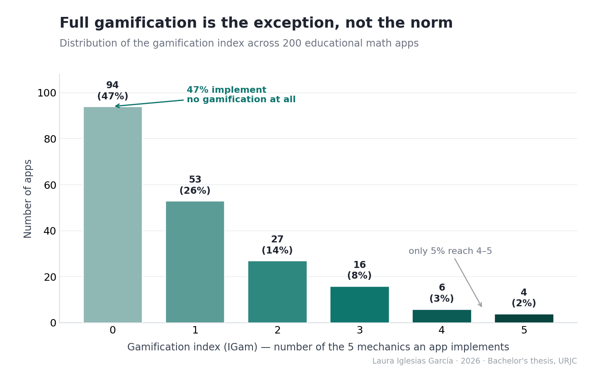
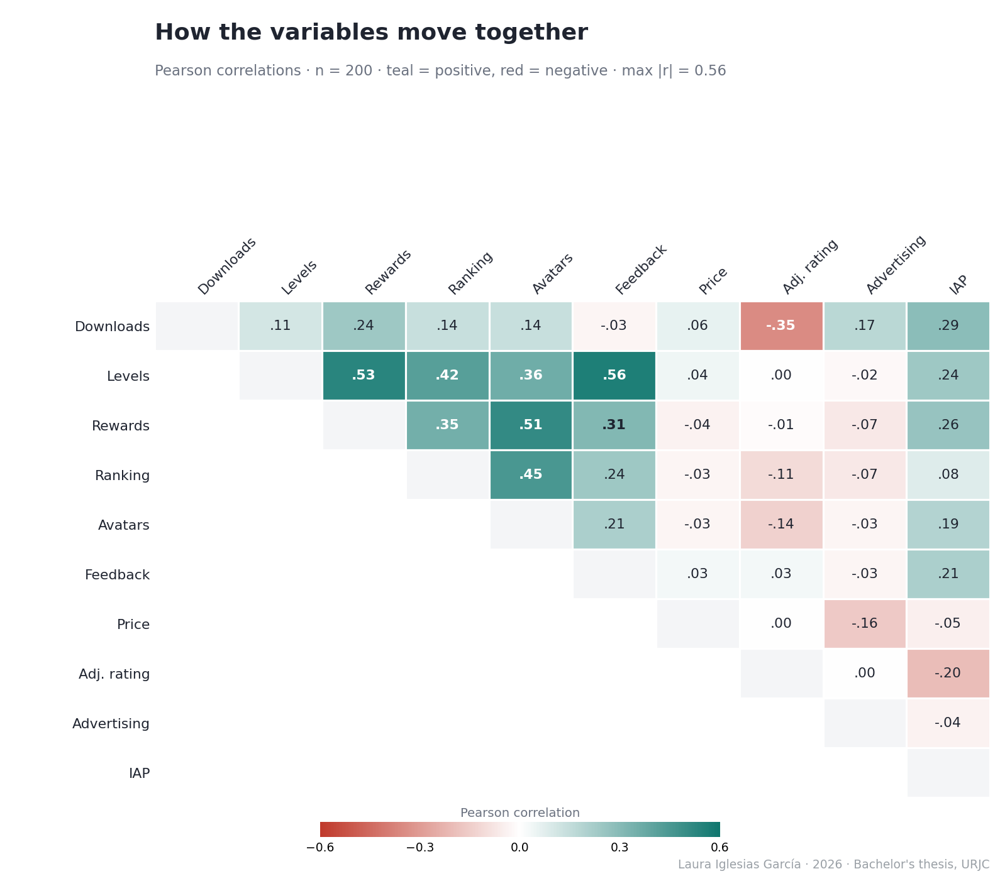
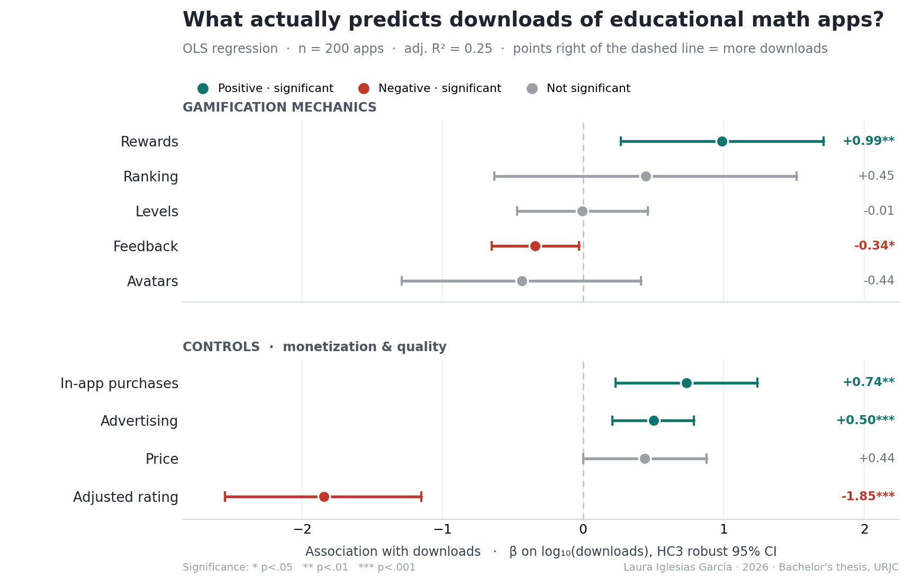

## Research question

Incorporating game mechanics (gamification) is one of the most common design
responses in educational apps. But which mechanics, if any, are actually
associated with **commercial success** (downloads) of primary-school math apps on
the Google Play Store? And is popularity a reliable signal of pedagogical quality?

This is an **observational, cross-sectional** study. All results describe
**statistical associations**, not causal relationships.

## Data & methods

| Stage | Detail |
|-------|--------|
| Source | Google Play Store Apps (Kaggle, gauthamp10, 2021), ~2.3M raw records |
| Cleaning | Deduplication, null handling, `Rating Count > 0`, numeric coercion |
| Target population | 4,218 educational **math** apps via a precision-oriented semantic keyword filter (validated recall gap ~6.4%) |
| Sampling | Stratified random sampling across four population quartiles of log10-downloads; n = 200, with 50 apps per stratum. The thesis reports stratum sizes of 1,054–1,055 apps and near-identical design weights (~21.09), motivating the use of unweighted OLS. |
| Coding | 5 binary gamification variables coded by manual interface inspection; inter-rater reliability via Cohen's kappa (κ = 0.831 after reconciliation) |
| Model | OLS, log-level form; HC3 robust standard errors; Halvorsen-Palmquist correction for dummy variables |
| Diagnostics | VIF, Breusch-Pagan, Shapiro-Wilk + Q-Q, Cook's distance |
| Robustness | Bootstrap (1,000 resamples), exact Fisher test, re-estimation without influential points, Bayesian-shrinkage hyperparameter sensitivity |

The five gamification mechanics: **Levels, Rewards, Ranking, Avatars, Feedback**.
Controls: **Price, adjusted Rating (Bayesian shrinkage), Advertising, In-app
purchases (IAP)**.

## The data at a glance

Before modelling, two patterns are worth seeing directly.

{#fig-igam fig-alt="Bar chart of the gamification index across 200 apps: 94 apps (47%) implement no mechanics, and only 10 apps (5%) implement four or five of the five mechanics." width="100%"}

{#fig-corr fig-alt="Heat map of Pearson correlations among the ten model variables; teal cells are positive, red cells negative, with the largest magnitude being 0.56." width="85%"}

## Key results: Model I (OLS, HC3 robust errors)

{#fig-coef fig-alt="Forest plot of nine regression coefficients with HC3 robust 95% confidence intervals. Intervals for levels, ranking, avatars and price include zero." width="100%"}

Dependent variable: `log10(downloads)`. Sample: 200 apps.
Adjusted R² = 0.248; F(9, 190) = 8.28, p < 0.001.

The table reports associations conditional on the other
variables included in the model. Statistical significance
is assessed at the 5% level.

| Predictor | β | p | Interpretation |
|---|---:|---:|---|
| Rewards | 0.986 | 0.008 | Positive association |
| In-app purchases | 0.736 | 0.005 | Positive association |
| Advertising | 0.501 | 0.001 | Positive association |
| Adjusted rating | -1.846 | <0.001 | Negative association |
| Feedback | -0.343 | 0.030 | Negative association |
| Levels | -0.006 | 0.979 | Not statistically significant |
| Ranking | 0.445 | 0.417 | Not statistically significant |
| Avatars | -0.436 | 0.315 | Not statistically significant |
| Price | 0.438 | 0.052 | Not statistically significant |

: {.striped .hover}

### Interpreting the rewards coefficient

Rewards were the only gamification feature with a statistically
significant **positive** coefficient in Model I. Feedback had
a statistically significant **negative** coefficient.

Because the outcome uses a base-10 logarithm, the rewards
coefficient corresponds to a multiplicative contrast of
`10^0.986`, approximately **9.7**, on the back-transformed
fitted scale, holding the included predictors constant.

This is a model-based association, not evidence that adding
rewards would multiply an app's downloads by 9.7. It should
not be interpreted directly as a ratio of arithmetic mean
downloads without additional retransformation assumptions.

The non-significant coefficients for levels, ranking and
avatars do not establish that these features have no effect
or that they are standard features shared by all successful apps.

### What the model does not measure

Downloads describe reach or popularity. User ratings describe
reported user evaluations. Neither directly measures learning
outcomes or pedagogical quality.

The negative coefficient for adjusted rating therefore does
not show that educational quality reduces popularity.
Similarly, the feedback coefficient alone cannot establish
that apps with feedback serve a particular type of audience.

## Robustness and sensitivity of the rewards association

The following checks examine sensitivity to influential
observations, resampling and selected modelling choices.
They use the same underlying dataset and are not independent
replications of the study.

| Check | Reported result | Interpretation |
|---|---|---|
| Excluding influential observations | β = 1.566, p < 0.001; adjusted R² = 0.322 | The positive association persists; its estimated magnitude increases |
| Bootstrap, 1,000 resamples | 95% coefficient interval [0.17, 1.64] | The interval excludes zero but indicates substantial uncertainty about magnitude |
| Fisher's exact test: download stratum × rewards | p = 0.002 | Evidence of an unadjusted association between rewards and download stratum |
| Rating-shrinkage sensitivity: six m0 values | β ranges from 0.954 to 1.006; p < 0.01 throughout | The rewards coefficient remains similar across the six tested settings |

The Fisher test examines a different, unadjusted relationship;
it does not validate the regression coefficient itself.

Together, these checks support the persistence of the positive
rewards association under the tested conditions. They do not
resolve unmeasured confounding, establish causality or guarantee
that the result generalises beyond the analysed apps.

## The code (illustrative)

The full, ordered scripts live in [`/R`](https://github.com/lauraiglesiasgr/gamification-math-apps-analysis/tree/main/R). Two representative excerpts:

**Bayesian shrinkage estimator for perceived quality**

```r
vi <- apps$`Rating Count`; Ri <- apps$Rating
C  <- mean(Ri, na.rm = TRUE)
m0 <- quantile(vi, 0.75, na.rm = TRUE)
apps$Rating_Adj <- (vi / (vi + m0)) * Ri + (m0 / (vi + m0)) * C
```

**Model I with HC3 robust standard errors**

```r
model_I <- lm(LogMaxInstalls ~ V_Niveles + V_Recompensas + V_Ranking +
                V_Avatares + V_Feedback + Price + Rating_Adj +
                ADS_bin + IAP_bin, data = apps)
coeftest(model_I, vcov = vcovHC(model_I, type = "HC3"))
```

## Takeaways

- **For product teams:** the positive association between rewards
  and downloads provides a hypothesis for further investigation.
  It does not establish the return from adding rewards or changing
  an app's monetisation model. Controlled experiments would be
  needed to evaluate those decisions.

- **For educators:** download counts and user ratings should not
  substitute for direct evidence of learning, accessibility or
  suitability for a particular classroom.

- **For analysts:** the interpretation depends on the outcome
  definition, sample, model specification and uncertainty.
  Robustness checks strengthen the assessment of an association
  within the tested conditions; they do not turn it into a
  causal effect.

### Limitations and next steps

This cross-sectional study measures associations at one point
in time. Unmeasured differences between apps, such as age,
marketing exposure or development resources, could influence
the observed relationships.

A stronger follow-up would use longitudinal data, additional
confounder measurements and experimental or credible
quasi-experimental designs. Educational effectiveness would
require separate learning-outcome measures.

---

*Full written thesis (Spanish) in [`/report`](https://github.com/lauraiglesiasgr/gamification-math-apps-analysis/tree/main/report). Code under MIT license;
data obtained from Kaggle (see [`/data`](https://github.com/lauraiglesiasgr/gamification-math-apps-analysis/tree/main/data)).*

