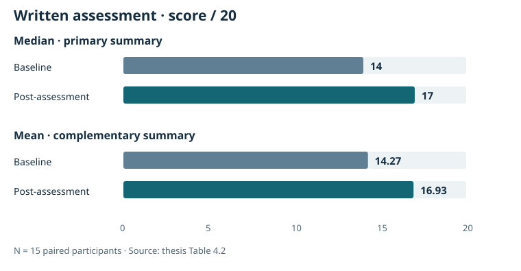
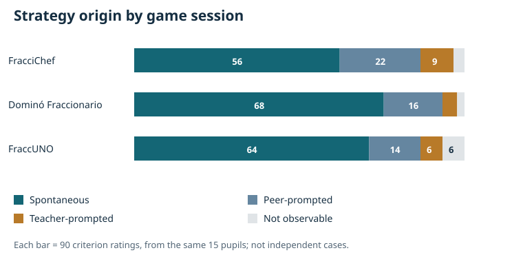
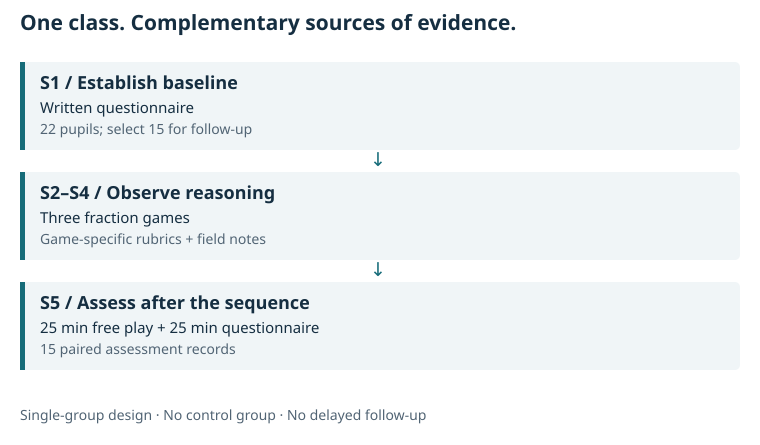
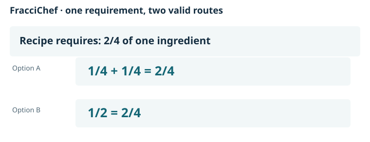
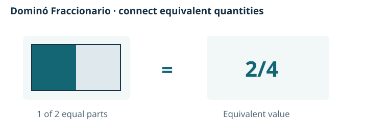
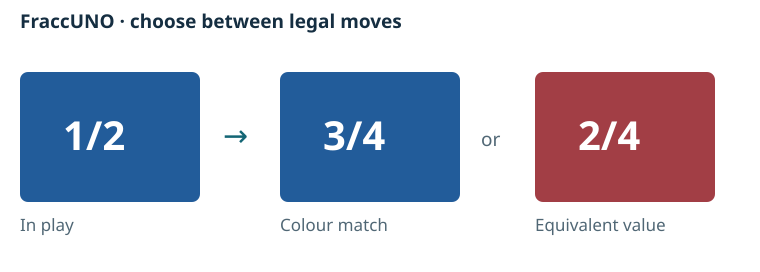

::: {.project-nav}
[Case study](index.qmd) · [Methods](methods.qmd) · [Results & evidence](evidence.qmd) · [Español](es.qmd) · [All projects](../projects.qmd)
:::

::: {.eyebrow}
Laura Iglesias García / Applied research / 2026
:::

::: {.hero-intro}
I designed and carried out a mixed-methods classroom study, from the research question and assessment instruments to data collection, statistical analysis and interpretation. Using fraction games, written tasks and structured observation, I investigated how pupils choose and explain mathematical strategies.
:::

::: {.hero-meta}
**My role:** study design · instrument development · data collection · quantitative and qualitative analysis

**Context:** Primary Education bachelor's thesis, Universidad Rey Juan Carlos · **Original analysis:** JASP
:::

::: {.hero-actions}
[Explore the findings](#findings){.btn .btn-primary} [Read the methods](methods.qmd){.btn .btn-outline-primary}
:::

## Findings at a glance {#findings}

::: {.finding-grid}
::: {.finding-card}
01

### Higher written scores

Median questionnaire scores rose from **14 to 17 / 20** in the follow-up sample. Thirteen scores increased and two stayed at the maximum.

:::
::: {.finding-card}
02

### Visible strategy choices

**188 of 270 criterion ratings** during the three games were coded as spontaneous. Other ratings recorded peer or teacher prompting, or were not observable.

:::
::: {.finding-card}
03

### Different evidence across formats

Qualitative observations raised questions about reasoning visible during play and the evidence captured by written tasks.

:::
:::

### Written assessment: before and after

<figure class="research-figure">
<picture>
<source media="(max-width: 600px)" srcset="assets/assessment-mobile.svg">

</picture>
<figcaption>Written questionnaire scores. Medians are the primary summary; means are complementary. Source: thesis Table 4.2.</figcaption>
</figure>

The mean change was **+2.67 points out of 20**. The thesis reports a paired Wilcoxon test with **W = 0, two-sided p = 0.001**. [Statistical detail and source tables →](evidence.qmd#statistical-reporting)

### Strategy origins during play

<figure class="research-figure">
<picture>
<source media="(max-width: 600px)" srcset="assets/strategy-origins-mobile.svg">

</picture>
<figcaption>Strategy-origin ratings. Each session contains 90 criterion ratings from the same 15 pupils. Source: thesis Table 4.1.</figcaption>
</figure>

Spontaneous strategies were the most frequent category in every session. Each game used a different rubric and appeared in a fixed order, so these bars describe observations rather than rank game effectiveness. [Accessible counts and provenance →](evidence.qmd#strategy-origin-counts)

## Research design {#design}

**Question:** What strategies become visible in multiple-solution fraction games, and how do written scores differ before and after the sequence?

I combined a pre-post comparison with observation and qualitative records. A class of **22 pupils** completed the baseline questionnaire. Five participants were selected by lottery within each of three baseline competence strata, producing a **15-participant follow-up sample**.

{fig-alt="S1: baseline questionnaire, 22 pupils, followed by stratified selection of 15. S2 to S4: three fraction games with rubrics and field notes. S5: 25 minutes of free play then 25 minutes of post-assessment. No control group or delayed follow-up."}

| Evidence source | What it contributed |
|---|---|
| Written questionnaires, scored out of 20 | Fraction knowledge, representations and explanations before and after the sequence |
| Six-criterion rubric for each game | Structured evidence of reasoning within each activity |
| Strategy-origin codes | Whether a strategy appeared spontaneously or following prompting |
| Field notes and open responses | Context for interpreting numerical patterns and differences between formats |

The approach was mixed-methods, with qualitative emphasis. Written scores, observation and field notes were interpreted together. [Sampling, instruments and analysis decisions →](methods.qmd)

## Inside the intervention {#intervention}

I designed three games to create more than one valid route to a solution. The aim was to make **procedure choice, representation and adaptation** observable.

::: {.game}
01 / Procedural emphasis

### FracciChef

{fig-alt="Recipe requirement: 2/4 of one ingredient. Valid option A: 1/4 plus 1/4. Valid option B: 1/2. Both meet the same requirement."}

Players combine ingredient cards to complete a recipe. Different equivalent combinations make it possible to observe which route a player chooses and how they justify it.
:::

::: {.game}
02 / Representational emphasis

### Dominó Fraccionario

{fig-alt="A rectangle divided into two equal parts with one shaded is linked by an equals sign to the fraction 2/4."}

A valid connection depends on equivalent quantities across visual and symbolic forms. Matching values requires looking beyond identical notation.
:::

::: {.game}
03 / Strategic emphasis

### FraccUNO

{fig-alt="Card in play: blue 1/2. Two valid options: blue 3/4, matching colour; red 2/4, matching equivalent value. The example illustrates a decision, not an observed pupil move."}

Players can have several legal moves. Choosing between a colour match and an equivalent value creates an opportunity to explain and adapt a strategy.
:::

The diagrams above are newly drawn explanations of documented rules, not reproductions of pupil work or the original card artwork. Each game was observed in one session, so game mechanics, rubric and order cannot be separated analytically.

## My analytical contribution {#contribution}

My contribution covered the research process from the question to interpretation. The decisions below show the methodological work behind the findings.

| Decision | Purpose | Evidence of skill |
|---|---|---|
| Include different baseline competence levels | Observe a range of starting profiles | Sampling design |
| Define rubrics and strategy-origin codes | Structure classroom observations | Operationalisation and data collection |
| Compare paired questionnaire scores | Examine within-participant change | Descriptive statistics and non-parametric testing |
| Read scores alongside field notes | Investigate agreement and divergence between sources | Mixed-methods interpretation |
| Examine ceiling effects and assessment demands | Bound the claims supported by the study | Measurement critique and analytical judgement |

**Tools and scope:** the original thesis reports JASP 0.18 for numerical analysis. Quarto and the Python aggregate-figure script were added later for this portfolio. The script regenerates figures from transcribed summaries; it does not reproduce the full original analysis.

## Interpretation & next study {#interpretation}

The study documents higher written scores after the sequence and a range of strategies during play. Its broader contribution is a research process that considers **both performance and how evidence of performance is collected**.

This exploratory study describes a change within one classroom. The absence of a control group, differences between assessment conditions and the short follow-up limit the conclusions. [Study limitations and measurement details →](methods.qmd)

A stronger next study would combine a comparison group, delayed follow-up, harmonised assessment conditions and independent observation. [Full methodological limitations →](methods.qmd)

## Documentation & related work {#documentation}

::: {.documentation-grid}
::: {.doc-link}
### Methods

Sampling, instruments, procedure and analytical choices.

[Explore the methodology →](methods.qmd)
:::
::: {.doc-link}
### Evidence & data

Source tables, statistical notes and data availability.

[Inspect the evidence →](evidence.qmd)
:::
::: {.doc-link}
### Español

Resumen del estudio, resultados y alcance.

[Leer en español →](es.qmd)
:::
:::

This case complements my work in mathematics and data analysis. [Explore my project on gamification and mathematics apps →](../gamification.qmd)

**Source:** Iglesias García, L. (2026). *Estudio de la flexibilidad matemática en Educación Primaria a través de juegos de resolución múltiple*. Primary Education bachelor's thesis, Universidad Rey Juan Carlos. This adaptation presents aggregate evidence; the original PDF and participant records are not redistributed.

[View the official university record](https://hdl.handle.net/10115/428077)

The university repository provides the thesis title, author,
date and academic supervisors. Access to the full thesis PDF
is restricted; this portfolio presents selected aggregate
findings and methodological details.
